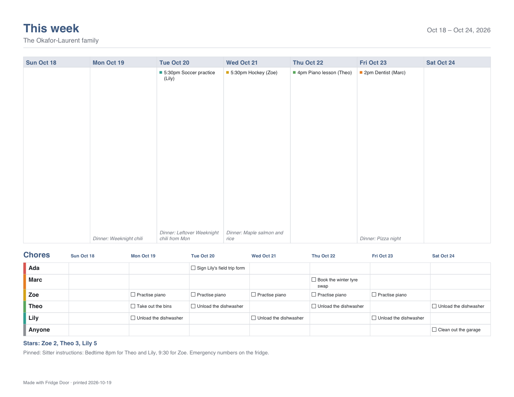

<p align="center"></p>

<h1 align="center">Fridge Door</h1>

<p align="center"><b>The household organizer that lives in your AI chat.</b><br>
The family calendar, to-dos and chores, the grocery list, recipes, the week's meals, notes and the household
budget, in one place. For someone living alone, a couple, a family or a flat share, in any country.</p>

---

Fridge Door is an agent plugin for **Grok Bot**, **Cursor**, **Grok Build** and **Claude Code** (and any agent
that reads [Agent Skills](https://agentskills.io)). Tell your agent "add milk", "Lily has soccer Tuesdays at
5:30" or "plan dinners this week", and it keeps everything straight with a local toolkit that does the dates,
repeats, quantities and money exactly. There's no account to create, no server and no subscription. Your
household's records are plain files on the computer your agent runs on.

<p align="center"></p>

## What it does

- **Today, at a glance.** Each morning: today's events, your tasks, tonight's dinner, the lists waiting to be
  shopped, birthdays coming up, bills due and anything new for you.
- **A shared calendar.** Events with times or all day, who they're for, reminders, and repeats ("every other
  Tuesday", "monthly on the 2nd Thursday"), one-off changes and skipped dates. Birthdays repeat by themselves.
  Private or members-only events stay that way. Import a school's calendar file, or export yours to Google,
  Apple or Outlook.
- **To-dos and chores.** Your own list, the household's list and any you make. Assign tasks, set repeats, and
  let chores take turns between people. Kids earn stars when a parent ticks their chores off.
- **Grocery and shopping lists that sort themselves.** Say it the way you would ("2 pints of milk", "eggs and
  bread") and items file into aisles (it knows courgette and zucchini, coriander and cilantro), in your store's
  order. Cross off, re-add in one step, and share as a message, a printout or a file.
- **Recipes that go straight to the list.** Save one from a link, a photo of a recipe card or by hand. Scale it,
  cook it step by step, and send its ingredients to the list: what's in the pantry is skipped, and amounts merge
  properly (2 cups + 1 cup = 3 cups, never mixing weight with volume).
- **The week's meals.** Plan dinners around busy evenings, count leftovers as a meal, and make the week's
  grocery list in one go. Swap a meal and only its share of the list changes.
- **Notes.** The wifi, the sitter's instructions, packing lists. Mark one sensitive and it stays out of group
  chats and printouts.
- **A simple household budget.** Monthly categories, spending (it can read a receipt photo and check with you
  first), recurring bills with reminders, savings goals, and a month report with charts. Exact to the cent, in
  your currency.
- **Reminders that respect quiet hours,** worded when they're sent, only in chats that may see them, and never
  twice.
- **Printables:** the one-page weekly fridge sheet above, month and week calendars, shopping checklists, recipe
  cards and a budget report, as PDF and web pages.

## Works anywhere

Nothing is hard-coded to one country. Setup takes three answers (who lives there, the country, and a name if
you like), and the country sets the rest, which you can change:

- Any currency, including those with no decimals (JPY, KRW) or three (KWD, BHD). Where a symbol is shared, the
  code shows too ("$1,234.50 CAD").
- Your time zone, date format (31/12, 12/31 or 2026-12-31), 12- or 24-hour clock, the day your week starts,
  metric or US units, and A4 or Letter paper.
- Any household: one person or eight, kids or none, flatmates, or an extended family across several
  households.
- Printouts are in English. Names and notes can be in any language; for scripts the built-in PDF fonts can't
  show, it prints through a browser already on your computer, or gives you the web page version.

## For parents

Fridge Door is made for the adults of a household. Kids and teens take part through you.

- **Kids don't chat with the AI.** The AI apps don't allow it (Claude and Cursor are for adults; Grok needs
  users to be 13 or older, with a parent's permission until 18), and it isn't needed. Only adults can be linked
  to a chat, and the owner confirms each one is 18 or older. If a teen is in your family group chat, you can
  tell Fridge Door so: it won't act on their messages, and that chat only shows kid-level things.
- **A child is a first name or nickname, a colour, their chores and a star count,** with no place for a
  surname, age, photo, school, location or health details. A child's birthday can go on the calendar as a day
  and month.
- **Kids join in on paper.** The weekly fridge sheet shows their chores with tick boxes and their stars. You tick
  chores off in chat ("Mia did the dishes") and Mia gets a star. There are no streaks, badges, characters or
  messages to kids.
- **Group chats with kids in them** only ever show chores and the grocery list.
- **You can see and delete everything.** Only the household owner adds or removes people; removing someone
  erases their details; deleting the household erases everything; finished chores and the activity log clear
  themselves after 90 days (you can change that).
- **Netty Labs receives no data.** The plugin has no networking code at all (a test fails if any is added), and
  no accounts, analytics, ads or telemetry.
- **Where your data is:** in files on the computer your AI agent runs on, and in your chats with it. If you use
  a hosted agent such as Grok Bot, those files and chats are on that service's servers, under its privacy
  policy and age rules; use its settings to delete them.
- **For personal and family use.** A school, daycare, club or business using it takes on its own legal
  obligations.

## Safe by design

- **Your OK first.** Nothing is sent outside your chat, paid or deleted without your say-so, and the owner
  decides who's in the household and who sees what.
- **Everyone sees only their share.** Access is set per person and per module (calendar, lists, recipes,
  budget...), private things stay private (the owner's export leaves them out too), and a group chat shows only
  what everyone in it may see. Bill reminders and private reminders only go to the person's own chat.
- **Exact, not guessed.** Dates, repeats, rotations, quantities and money come from a tested toolkit, never from
  the AI's head.
- **No network, no credentials, no telemetry.** See [SECURITY.md](SECURITY.md).

## Install

**Grok Bot**: open **Plugins** in the sidebar, search for **Fridge Door**, and add it. Then say "set us up".

**Cursor**: install **Fridge Door** from the Cursor Marketplace. For a local copy:
`git clone https://github.com/nettylabs/fridge-door ~/.cursor/plugins/local/fridge-door`, then reload.

**Grok Build**: `grok plugin install nettylabs/fridge-door --trust`

**Claude Code**: `/plugin marketplace add nettylabs/fridge-door`, then `/plugin install fridge-door@nettylabs`

**Any agent with a terminal**: point it at this repository and say: *"Clone
https://github.com/nettylabs/fridge-door and follow skills/fridge-door/SKILL.md."*

Requires Python 3.9 or newer, standard on most Linux machines, including typical agent cloud computers. On a Mac or
PC without it, install it from python.org. Nothing to `pip install`.

## Try it in two minutes

Ask your agent:

1. "Set up a Fridge Door **demo** household and show me today." (runs `fridge demo` in a separate folder)
2. "Add milk x2, eggs and dish soap to the grocery list."
3. "Zoe has a school concert next Friday at 7pm. Remind me the day before."
4. "Plan dinners for the rest of the week and show me the grocery list before adding it."
5. "Theo took the bins out and Lily unloaded the dishwasher."
6. "Print this week's fridge sheet."

Or run the toolkit yourself:

```bash
python3 skills/fridge-door/scripts/fridge.py selftest                       # built-in checks
python3 skills/fridge-door/scripts/fridge.py --home /tmp/fridge-demo demo --region CA
python3 skills/fridge-door/scripts/fridge.py --home /tmp/fridge-demo today
python3 skills/fridge-door/scripts/fridge.py --home /tmp/fridge-demo print week
```

The demo regions are CA (a family of five), GB (a couple), AU (three flatmates) and US (a single parent).

## How it's built

```text
skills/fridge-door/
  SKILL.md             what the agent does, and its golden rules
  references/          setup and members, lists and chores, calendar, recipes and meals,
                       notes and budget, today and printables, and the full command reference
  scripts/fridge.py    the toolkit (JSON in, JSON out; `fridge --help` for everything)
  scripts/fridgedoor/  households and access, lists, chores, calendar, recipes, meals, notes, budget,
                       reminders, calendar files, and the PDF and HTML printables
commands/              /fridge-door-setup, /household-today, /plan-meals, /fridge-sheet
tests/                 python3 -m unittest discover -s tests
```

It works alongside your agent's own tools: it reads a recipe page or calendar file your agent saved, and your
agent passes reminders and printouts on in the chat. It never connects to anything itself.

## Support

Questions, bugs or ideas: [open an issue](https://github.com/nettylabs/fridge-door/issues). Please don't paste
your household's files, or children's names or details, into an issue.

## License

MIT © 2026 Verkholm Inc. Netty Labs is a brand of Verkholm Inc. Fridge Door helps you organize your household;
it doesn't give financial, legal or medical advice.
